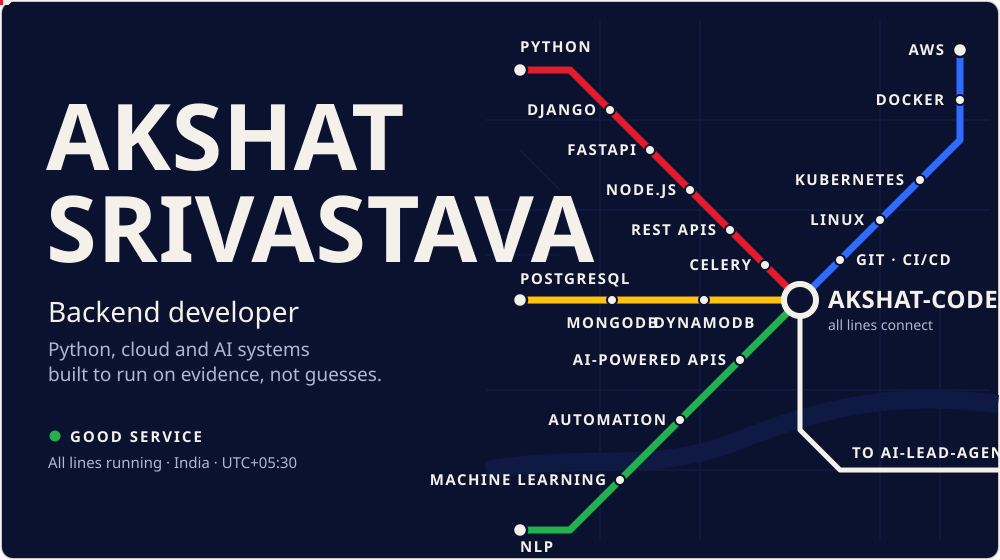
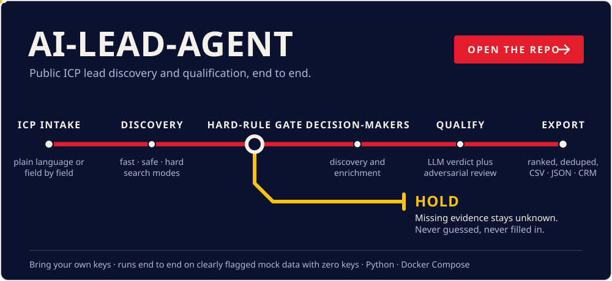
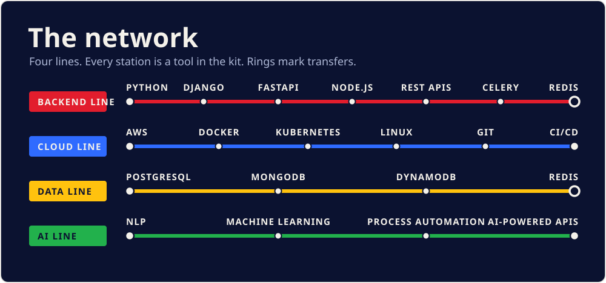
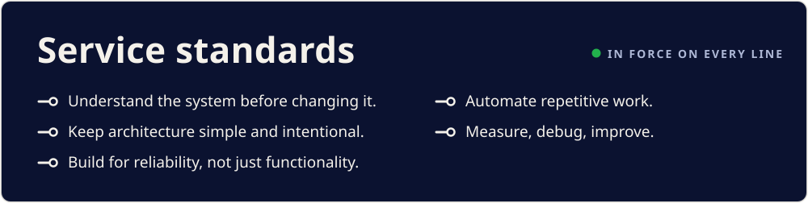

<picture>
  <source media="(max-width: 600px)" srcset="./assets/hero-m.svg">
  
</picture>

  
  &nbsp;
  

 

<a href="https://github.com/akshat-codex/ai-lead-agent">
  <picture>
    <source media="(max-width: 600px)" srcset="./assets/route-ai-lead-agent-m.svg">
    
  </picture>
</a>

  

<picture>
  <source media="(max-width: 600px)" srcset="./assets/network-m.svg">
  
</picture>

  

<picture>
  <source media="(max-width: 600px)" srcset="./assets/standards-m.svg">
  
</picture>

  

  

  
  &nbsp;
  
  &nbsp;
  

